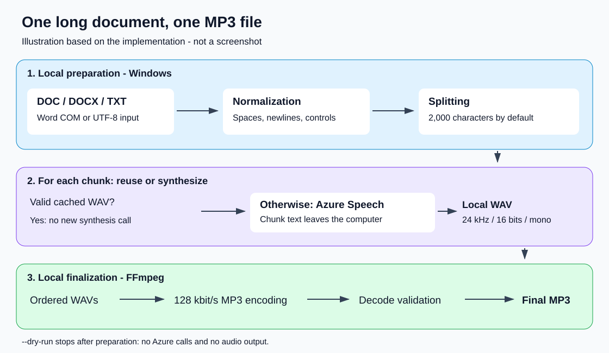
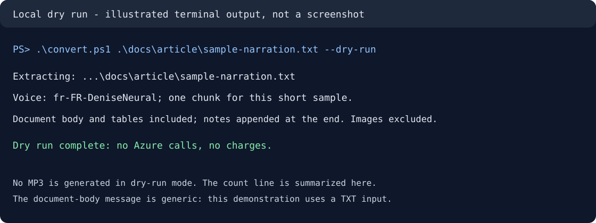

# From Word Read Aloud to a standalone MP3

> A detailed source dossier for writing an article, not the finished article.
> Based on the implementation and local checks performed on October 14, 2026.
> Separate verified behavior, executed checks, and potential improvements.

## 1. Project and publication

Public repository: **[jlou07/WordToMp3](https://github.com/jlou07/WordToMp3)**.

The repository brings together the command-line application, documentation,
tests, a non-sensitive demonstration text, and explanatory illustrations.
Documentation, CLI messages, test fixtures, and illustration labels are English.

The public version removes the original personal Azure endpoint and the
personalized document lookup. A document path is required. Each user supplies
their own endpoint and key for synthesis; a dry run requires neither.

Secrets are not moved into another published configuration file.
[.env.example](.env.example) contains placeholders only; real `.env` files
are excluded by [.gitignore](.gitignore). The application does not
automatically load `.env` files.

The existing default narration voice, `fr-FR-DeniseNeural`, is retained.
An English interface does not imply that the source document or generated
narration must be English. Select a suitable available voice with `--voice`.

## 2. The starting point

**Word can read my document aloud, but I want a standalone MP3 I can take
with me. Because the document is long, I automate the conversion.**

This is not simply about making a computer speak. The desired output is a
durable, portable audio file that can be replayed independently of Word.

Possible uses include listening to a manuscript, reviewing writing by ear,
taking a narrative on a journey, or sharing an audio version with someone
who prefers listening to reading.

### Get the terminology right

| Feature | Direction | Purpose |
|---|---|---|
| Word Dictate | Speech to text | Speak to write a document. |
| Word Read Aloud | Text to spoken playback | Listen to a document inside Word. |
| WordToMp3 | Document to extracted text to synthesized audio to MP3 | Produce a standalone recording. |

The starting point is **Read Aloud**, not Dictate. Say "generate an audio
file from my text," not "record the dictation."

Do not claim that no Word edition, extension, or workflow can ever export
audio. This dossier is not an exhaustive comparison of Word versions.
The concrete distinction is that this application does not capture Word's
playback: it extracts text and requests a new narration from Azure Speech.

## 3. Why use a script for a long document?

A script is not the only conceivable solution. An audio-export application
or a recording workflow could also be considered. This project's value is
a reproducible and recoverable processing pipeline.

Long documents raise practical questions:

- How do I read an older Word format without modifying the source?
- How do I avoid a single oversized synthesis request?
- What happens if the network fails halfway through?
- How do I preserve passage order?
- Can I reuse audio that has already been generated?
- How do I get one MP3 rather than hundreds of separate files?
- Can I check technical readability before publishing the output?
- How do I keep credentials and private document contents out of GitHub?

Python orchestrates the process. Azure Speech generates speech. FFmpeg
assembles and encodes the final audio. Word is used for text extraction,
not as the speech-generation engine.

## 4. What the application actually contains

This is a **Windows command-line application**, normally launched from
PowerShell. It has no graphical interface, website, or application server.

| File | Role |
|---|---|
| [convert.ps1](convert.ps1) | Uses the local virtual environment, forwards arguments, returns the exit code. |
| [convert.py](convert.py) | Implements extraction, splitting, synthesis, caching, and finalization. |
| [requirements.txt](requirements.txt) | Declares the three direct dependencies. |
| [test_convert.py](test_convert.py) | Contains local tests with mocked Azure responses. |
| [README.md](README.md) | Installation and day-to-day usage. |
| [.env.example](.env.example) | Lists configuration names without real credentials. |
| [sample-narration.txt](docs/article/sample-narration.txt) | Original non-sensitive demonstration input. |

Dependencies:

```text
azure-cognitiveservices-speech>=1.40,<2
pywin32>=306; sys_platform == "win32"
imageio-ffmpeg>=0.6,<1
```

- The Speech SDK communicates with Azure.
- `pywin32` automates Word through COM on Windows.
- `imageio-ffmpeg` supplies the FFmpeg executable.
- Python's standard library handles arguments, paths, hashing, JSON,
  temporary files, process execution, timing, and WAV inspection.

There is no separate system FFmpeg installation in the documented setup.

## 5. Illustrated architecture



*Implementation diagram, not a screenshot.*

```text
DOC / DOCX / UTF-8 TXT
        |
        v
Local extraction and normalization
        |
        v
Text chunks: 2,000 characters by default
        |
        v
For each chunk:
    Valid cached WAV? -- yes --> reuse it
        |
        no
        |
        v
    Azure Speech -> temporary WAV -> validate -> cached WAV
        |
        v
Ordered WAV list
        |
        v
FFmpeg: encode one MP3
        |
        v
Decode check -> publish final output
```

`--dry-run` stops after extraction and splitting. It does not request a
key, generate audio, or make Azure calls.

## 6. Installation and prerequisites

For Word input, the intended setup requires:

- Windows and Microsoft Word installed;
- Python and a local virtual environment;
- the declared dependencies;
- an Azure Speech resource with a usable endpoint, key, and voice;
- network access for real synthesis;
- sufficient disk space for cached WAV files and the final MP3.

TXT extraction does not use Word. This does not establish end-to-end
support for every other operating system.

```powershell
python -m venv .venv
.\.venv\Scripts\python.exe -m pip install -r requirements.txt
.\convert.ps1 --help
```

The local environment used during preparation was Python **3.11.9**.
This is an observed environment, not a formally established minimum version.

The launcher does not create the environment automatically. If it cannot
find the expected interpreter, it stops with installation instructions.

## 7. Demonstration: inspect before synthesizing

### Local dry run

```powershell
.\convert.ps1 .\docs\article\sample-narration.txt --dry-run
```

The output reports:

1. The resolved input path.
2. The normalized character count, chunk count, and selected voice.
3. A generic reminder about document elements.
4. Confirmation that no Azure calls or charges occurred.



*Illustration, not a native PowerShell screenshot. The path is abbreviated
and the count line summarized to avoid inventing a verbatim transcript.*

The document-body reminder is generic. With a TXT input, it does not mean
Word was opened or any Word-specific extraction was exercised.

A dry run checks local extraction and splitting. It does **not** validate
the key, resource quotas, voice availability, or spoken audio quality.

### Real conversion

```powershell
$env:AZURE_SPEECH_ENDPOINT = "https://your-resource.cognitiveservices.azure.com/"
.\convert.ps1 "C:\Documents\book.docx" --dry-run
.\convert.ps1 "C:\Documents\book.docx" -o "C:\Audio\book.mp3"
```

The last command requests billable synthesis when required chunks are not
already cached. It is usage guidance, not evidence of a live conversion
performed while preparing this dossier.

If `AZURE_SPEECH_KEY` is unset, the program asks for it with a hidden prompt.
Do not put a real key into a published command, terminal history, or screenshot.

Use placeholder endpoints in the article. The public application has no
personal default endpoint.

### No-argument behavior

The input path is mandatory. Missing it produces an argument-parser error.
The personalized lookup used by the initial local prototype was removed
before publication; the application does not search private folders.

## 8. Complete command-line reference

| Argument | Default or constraint | Meaning |
|---|---|---|
| `document` | Required | DOC, DOCX, or UTF-8 TXT path. |
| `-o`, `--output` | Same directory and base name as the input, `.mp3` extension | Output path. |
| `--endpoint` | `AZURE_SPEECH_ENDPOINT`, otherwise absent | Required for real synthesis; optional for dry runs. |
| `--voice` | `fr-FR-DeniseNeural` | Narration voice. |
| `--chunk-size` | `2000`, range `100` to `3000` | Maximum Python characters per chunk. |
| `--attempts` | `4`, range `1` to `10` | Total synthesis attempts per chunk. |
| `--overwrite` | Disabled | Allow replacing an existing MP3 after successful finalization. |
| `--dry-run` | Disabled | Extract and count without synthesis. |
| `-h`, `--help` | Not applicable | Display usage information. |

```powershell
.\convert.ps1 "C:\Documents\book.docx" --chunk-size 1500 --dry-run
.\convert.ps1 "C:\Documents\book.docx" --voice "en-US-JennyNeural"
.\convert.ps1 "C:\Documents\book.docx" --attempts 6
.\convert.ps1 "C:\Documents\book.docx" --overwrite
```

Only the command containing `--dry-run` is a simulation. Check the selected
voice's availability and suitability for your document before synthesis.

## 9. Text extraction: Word reads the file, not the narration

TXT input is read with `utf-8-sig`, accepting UTF-8 with or without a BOM.

For DOC and DOCX, the program:

1. Initializes COM.
2. Creates a separate Word instance with `DispatchEx`.
3. Keeps it invisible and disables alerts.
4. Disables macros for the opening operation and automatic link updates.
5. Opens the document read-only without adding it to recent files.
6. Reads `document.Content.Text`.
7. Appends footnotes, then endnotes.
8. Closes without saving, quits that Word instance, and releases COM.

The intention is to preserve the original and avoid reusing the user's
already-open Word session. These settings are not a complete security
boundary for arbitrary untrusted documents.

| Document element | Current treatment |
|---|---|
| Main body | Extracted. |
| Tables in the body | Text extracted; control markers normalized. |
| Footnotes | Appended after the main text, not narrated at their original references. |
| Endnotes | Appended after footnotes. |
| Images and scanned pages | No OCR. |
| Headers and footers | No dedicated extraction. |
| Floating text boxes | No dedicated extraction. |
| Visual layout | Not translated into an audio production script. |

Table extraction does not automatically produce a clear spoken explanation.
Successful technical extraction is not the same as a polished narration.

Protected or complex files may fail. There is no interactive document
unlocking workflow.

## 10. Normalization and splitting

`normalize_text` unifies line endings, replaces certain Word control
characters with newlines, removes disallowed control characters, collapses
horizontal whitespace, limits repeated blank lines, and trims boundaries.

It does not summarize, rewrite, expand abbreviations, or infer how a date
or proper name should be pronounced.

`split_text` prefers:

1. A paragraph boundary in the second half of the available window.
2. Otherwise, a simple punctuation-based sentence boundary.
3. Otherwise, whitespace.
4. Finally, the hard character limit for a long unbroken token.

The default limit is **2,000 Python characters**, not words, model tokens,
or UTF-8 bytes. Tests check word preservation after whitespace normalization.
Do not promise byte-for-byte preservation: whitespace and controls are
deliberately transformed.

Small chunks make recovery more granular and reduce the risk of overly
long requests. There is no sophisticated language-aware sentence parser.

### Service limits versus implementation safeguards

The initial project documentation referred to 10-minute audio responses
and a 64 KB SSML limit. These external values must be checked against the
current API, voice, and offering before publication.

The code calls `speak_text_async` with plain text; it does not build SSML.
The implemented WAV safeguard rejects durations **greater than or equal
to 540 seconds**, or nine minutes. This check happens after receiving
audio; it does not prove every possible truncation will be detected.

## 11. Azure synthesis

The program configures:

- a subscription key and HTTPS endpoint;
- the chosen voice;
- `Riff24Khz16BitMonoPcm` intermediate output;
- `SpeechSynthesizer(..., audio_config=None)` to obtain audio in memory;
- `speak_text_async(text).get()` for each chunk.

Despite the SDK method's asynchronous name, `.get()` is awaited inside a
regular loop: chunks are processed **sequentially**, not in parallel.

Chunk text leaves the computer. The Word document is not uploaded as a
document file by this application.

There is no conversational model rewriting the content, no voice cloning,
and no guarantee of matching Word's Read Aloud voice.
Chunk boundaries may influence rhythm or intonation. No prosody-smoothing
pass is implemented.

## 12. Cache and recovery

The cache lives alongside the requested output:

```text
book.mp3
book.speech-cache/
  <SHA-256 fingerprint>/
    .lock
    00001.wav
    00002.wav
    ...
    concat.txt
```

The fingerprint hashes a JSON identity containing an internal version,
the exact normalized chunks, voice, endpoint, and intermediate audio format.
The identity JSON itself is not saved as a text manifest.

On a repeated run, each existing WAV is checked before reuse. Invalid
cached audio is removed and regenerated. Missing chunks are synthesized.

Text, voice, or endpoint changes can change the fingerprint. Changing
chunk size only changes it if the resulting chunk list changes.
Moving or renaming the output changes the cache location; the program
does not search for caches elsewhere.

**Billing nuance:** valid reused chunks are not submitted for synthesis
again. This is not a blanket promise of a free rerun. Missing, deleted,
invalid, or never-saved results may require new requests.

The key is requested and the synthesizer initialized before the reuse
loop. There is no explicit credential-independent reassembly command,
even when all required chunks are already cached.

### Conversion lock

An exclusively created `.lock` inside the fingerprint directory contains
the process ID. This blocks concurrent work against that cache, not every
conversion across the entire machine or every fingerprint targeting the
same MP3 name.

The lock is removed during normal finalization and exception unwinding.
A forceful process or machine shutdown may leave it behind. Check that
the associated conversion has stopped before manually removing it.

## 13. Errors, retries, and interruption

Recognized transient Speech errors are `ConnectionFailure`,
`ServiceTimeout`, `ServiceUnavailable`, and `TooManyRequests`.

The default is **four total attempts**, not four retries after the first.
Delays use `min(2 ** attempt, 30)`: with the default, waits are 2, 4, and
8 seconds. Authentication failures and errors outside the transient set
stop the conversion.

The Azure error message constructed in `synthesize_chunk` replaces the
exact key string with `[key redacted]`. This is not universal log
anonymization: paths and other error context may still appear.

- Successful completion returns 0.
- Handled value, runtime, OS, and import errors print `Error: ...` and return 1.
- Argument-parser errors return 2.
- `Ctrl+C` prints a resume instruction and returns 130.

Completed cached chunks remain available after interruption.

## 14. Why WAV chunks and one MP3 encoding pass?

Intermediate uncompressed WAV files are straightforward to validate and
order. FFmpeg then encodes the ordered sequence once, rather than naively
joining independently compressed MP3 files.

`wav_duration` checks:

- mono audio;
- two-byte, 16-bit samples;
- a 24,000 Hz sample rate;
- a positive frame count;
- readable data consistent with the declared frame count;
- a duration strictly below nine minutes.

New audio is written to `.partial.wav`, checked, and only then renamed to
its completed chunk name.

The assembler writes `concat.txt` in chunk order with five-digit WAV
names. It uses `libmp3lame`, **128 kbit/s**, **24 kHz**, **mono**.
Encoding happens in a temporary directory beside the output.

A second FFmpeg pass decodes the entire MP3 with error termination
enabled. Only after successful encoding and validation is the final
output replaced. `--overwrite` is required when an MP3 already exists.

These checks establish technical readability, not correct pronunciation,
perfect content coverage, or listener satisfaction. Listen before sharing.

## 15. Runtime, storage, and cost

No full-book benchmark was performed for this dossier. Do not invent
conversion times, narration durations, or a throughput claim.
Network latency, text length, voice behavior, quotas, retries, and encoding
all influence wall-clock processing time. Audio duration is not compute time.

Format-based storage estimates:

- PCM WAV: `24,000 * 2 * 1 = 48,000 bytes/second`, approximately
  **172.8 MB/hour**, excluding headers.
- MP3 at 128 kbit/s: approximately **57.6 MB/hour**, excluding metadata
  and container-related differences.

These are decimal MB and calculated estimates, not book measurements.
During encoding, allow for cached WAVs, a temporary MP3, and possibly the
previous output still awaiting replacement.

Dry runs count text and chunks but do not produce a quote.
Pricing must be checked for the actual voice, offering, region, and
applicable billing rules. No current price was verified for this dossier.
Local character counts are an estimation aid, not an exact billing meter.

## 16. Privacy and public-repository precautions

- Synthesized text is sent to Azure Speech.
- Audio files and cached chunks can reveal the entire document contents.
- The application does not encrypt its cache.
- Logs can reveal file names and local paths.
- The application does not store the Azure key in its cache.
- Service retention and data-handling policies require separate verification.
- Regenerate any exposed credential rather than merely deleting its visible copy.

Use original non-sensitive content in demonstrations. Do not publish
family documents, real keys, certificate files, private resource names,
or screenshots containing personal information.

The ignore rules exclude real `.env` files, Word/PDF input, audio, speech
caches, virtual environments, and common key files. Private TXT files
outside the ignored `local` directory are not automatically excluded.
Review the staged file list, not only the working directory.

The public configuration template does not load itself. Set environment
variables in PowerShell or pass `--endpoint`; keep the key in the hidden
prompt if it is not already managed in your process environment.

## 17. Evidence and test coverage

The first local preparation ran nine original tests successfully. Four
configuration tests were then added for the public version:

1. The document path is required.
2. Explicit `--endpoint` overrides the environment variable.
3. Dry-run mode needs no Azure endpoint or key and writes no output.
4. Real conversion without an endpoint stops before requesting a key.

The suite now contains **13 tests**. The original nine cover:

- control-character normalization;
- word preservation and chunk bounds;
- a long unbroken token;
- Unicode, exact boundaries, empty input, and invalid chunk size;
- truncated WAV detection;
- real local FFmpeg encoding of two WAVs and decoded duration;
- preserving existing output after encoding failure;
- recovery from a mocked transient Azure failure;
- stopping on mocked authentication failure and redacting the key.

After translating the CLI and renaming the modules, all **13 tests passed**
in approximately 2.3 seconds. The English `--help` command succeeded, and
a dry run with the Azure endpoint and key unset succeeded with
**307 characters and one chunk**. No audio was generated.

```powershell
.\.venv\Scripts\python.exe -m unittest -v test_convert.py
```

The encoding test uses locally generated silence. It tests assembly, not
Azure voice quality. Azure responses are mocked and incur no service charge.

No live Azure synthesis, real Word COM extraction, full-book conversion,
or listening assessment was performed to prepare the article material.
The complete cache-resume path and conversion lock are not tested end to end.

Before publishing performance or audio-quality claims, perform a real
conversion on non-sensitive text and record the measurements separately.

## 18. Visuals and screenshots

Included:

1. [Architecture diagram](docs/article/architecture.svg).
2. [Dry-run terminal illustration](docs/article/dry-run.svg).

Both are illustrations, not native application screenshots.
The terminal illustration abbreviates the local path and summarizes the
count line. Do not present it as a verbatim execution transcript.

There is no web dashboard to capture. Do not invent one.

| Suggested real screenshot | What it should demonstrate | Precaution |
|---|---|---|
| Word Read Aloud | The original listening workflow | Use sample content and identify the Word version. |
| Terminal `--help` | Available arguments | Hide personal paths if needed. |
| Terminal `--dry-run` | Extraction and chunk counts | Use the supplied non-sensitive sample. |
| Real synthesis progress | Chunk messages and final assembly | Requires Azure access and can incur charges. |
| A resumed run | `Reused` messages | Keep the text, voice, endpoint, and output location unchanged. |
| File explorer and media player | A real, playable single MP3 | Avoid displaying unrelated private files. |

When handing this material to another AI or computer, keep this Markdown
with `docs\article`. Some tools do not automatically import linked images;
attach the SVG files separately when necessary.

## 19. Possible improvements, not current features

| Current limitation | Possible future work |
|---|---|
| Word input requires Word and Windows | Evaluate another extraction engine and fidelity. |
| No OCR | Add a separate scanned-page processing pipeline. |
| Notes appended at the end | Define a deliberate narration policy for notes. |
| No chapter selection | Add structured extraction and optional chapter outputs. |
| No speed or pause options | Add prosody controls and an SSML strategy. |
| Sequential synthesis | Investigate bounded concurrency within quotas. |
| No price estimate | Add an explicitly dated, offering-specific estimate. |
| Unencrypted cache | Define protection, retention, and deletion policies. |
| No graphical interface | Add one only if justified by the intended users. |
| No semantic audio validation | Add listening and content-check procedures. |
| No dedicated reassembly mode | Support explicit local re-encoding from cache. |

Do not describe these ideas as delivered functionality.

## 20. Suggested article structure

Possible titles:

- "Word Reads My Text Aloud, but I Want an MP3"
- "Turning a Long Word Document into One MP3 with Python and Azure Speech"
- "From Written Story to Audio: Chunking, Recovery, and MP3 Export"

Narrative:

1. Start with the practical wish to listen away from Word.
2. Distinguish Dictate, Read Aloud, and audio-file generation.
3. Explain why document length introduces recovery and assembly concerns.
4. Introduce the PowerShell launcher and Python orchestrator.
5. Walk through COM extraction, splitting, Azure, caching, and FFmpeg.
6. Demonstrate a dry run, then a genuinely executed live conversion if available.
7. Explain why reuse of completed chunks matters.
8. Close with privacy, costs, limits, and the need for listening checks.

Prefer:

- "The script generates a new narration from extracted text."
- "Valid cached chunks avoid new synthesis calls for those chunks."
- "The MP3 is decoded to check technical readability."

Avoid:

- "It exports Word's exact voice."
- "Everything runs offline."
- "It is free."
- "Every document element is read."
- "Truncation is impossible."
- "A whole book took just minutes," without actual measurements.
- "These screenshots prove a successful Azure conversion."

## 21. Ready-to-use brief for an AI writer

```text
Write an English article using the attached dossier as factual source material.

Angle:
Word Read Aloud lets me listen inside Word, but I want a standalone MP3
for a long document. I automated the pipeline with Python, Word COM,
Azure Speech, and FFmpeg.

Use a personal, clear, practical tone.
Explain the need before the architecture.
The dossier is evidence, not an article to copy verbatim.

Rules:
- Distinguish Dictate, Read Aloud, and audio-file generation.
- Do not say the script records or exports Word's playback voice.
- Do not invent conversion times, book length, prices, user feedback,
  audio-quality results, or a completed live Azure conversion.
- Separate implementation behavior, executed checks, and future ideas.
- State that text is transmitted to Azure Speech.
- Explain chunk reuse, intermediate WAVs, and one final MP3 encoding.
- Label the SVG visuals as illustrations, not screenshots.
- Use "to be completed" wherever supporting evidence is missing.
- Recheck service limits, voices, and official pricing before
  publishing precise external values.
- Never include credentials or private document/resource information.
- Link to https://github.com/jlou07/WordToMp3.

Provide a title, introduction, short sections, a few usable commands,
accurate image captions, and a balanced conclusion.
```

## 22. Sources and final fact-checks

Local primary sources:

- [Main implementation](convert.py).
- [PowerShell launcher](convert.ps1).
- [Usage documentation](README.md).
- [Dependency declarations](requirements.txt).
- [Local tests](test_convert.py).
- Local help, dry-run, and test executions.

Official references to consult before publication; their current contents
were not independently verified during this preparation:

- [Azure Speech documentation](https://learn.microsoft.com/azure/ai-services/speech-service/).
- [Text-to-speech overview](https://learn.microsoft.com/azure/ai-services/speech-service/text-to-speech).
- [Speech quotas and limits](https://learn.microsoft.com/azure/ai-services/speech-service/speech-services-quotas-and-limits).
- [Supported languages and voices](https://learn.microsoft.com/azure/ai-services/speech-service/language-support?tabs=tts).
- [Azure Speech pricing](https://azure.microsoft.com/pricing/details/cognitive-services/speech-services/).
- [Microsoft Word support](https://support.microsoft.com/word): find
  "Read Aloud" and "Dictate" for the version demonstrated.

Ideally add a live conversion of short non-sensitive text, an actual listening
check, and native screenshots. For a book, measure processing time, audio
duration, and final file size separately.
